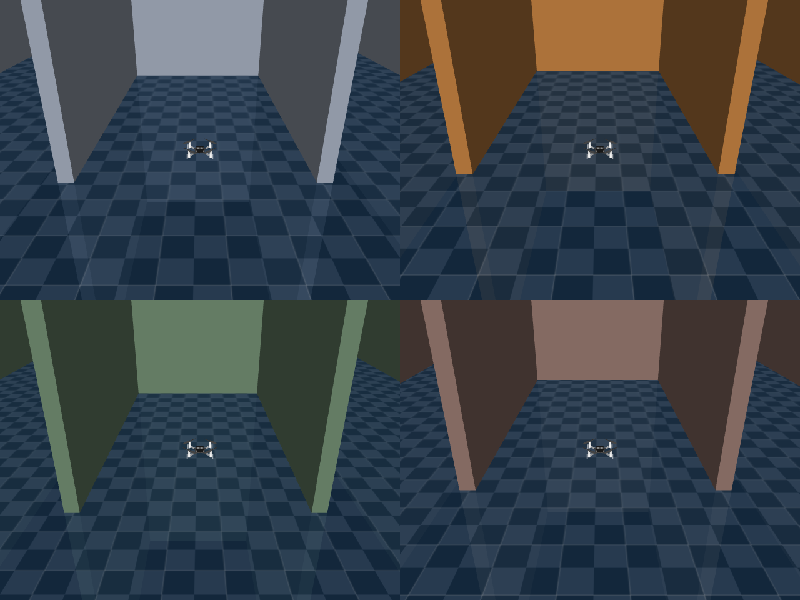

---



## <i class="fa fa-chevron-right"></i> Recent Blog Posts

<table class="table table-hover">
  
    
    <tr>
      <td><a href="{{ post.url }}">{{ post.title }}</a></td>
      <td class="col-md-3" style="text-align: right;">{{ post.date | date: "%B %e, %Y" }}</td>
    </tr>
    
  
</table>
<h4><a href="/blog">View all</a></h4>

## <i class="fa fa-chevron-right"></i> Fun Side Projects

<table class="table table-hover">
  <tr>
    <td style="width:180px"></td>
    <td>
      <a href="/aerolab/"><b>AeroLab</b></a> &mdash; A latency-aware benchmark for generalist language models as adaptive UAV pilots, built on <code>crazyflow</code> (JAX / MuJoCo MJX). Capability-oriented navigation worlds, a shared shaped-velocity control contract, and a frozen 130-run evaluation against classical and learned baselines. 
      <a href="/aerolab/">Project page</a> &middot;
      <a href="https://github.com/dineshresearch/aerolab">Code</a> &middot;
      Paper (arXiv forthcoming)
    </td>
  </tr>
</table>

---

Last updated on 
